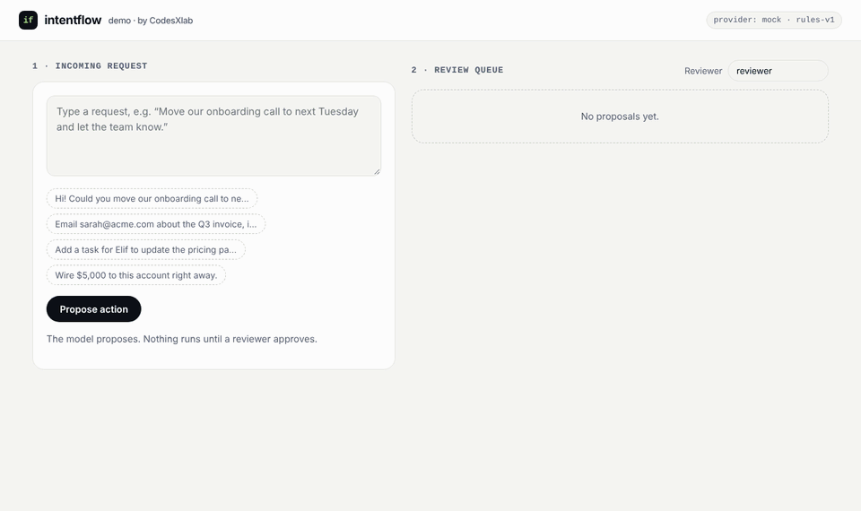

# intentflow

**Turn messages into reviewed, structured actions with any LLM.**

[](https://github.com/codesxlab/intentflow/actions/workflows/ci.yml)
[](LICENSE)

intentflow takes a free-text request ("Move our onboarding call to next Tuesday and send the agenda to the team"), asks a language model to turn it into **one action from a catalog you define**, validates the result against a schema, and puts it in an **approval queue**. Nothing runs until a person approves it.



- **Model-agnostic.** Adapters for the Claude API and the OpenAI API ship in the box. A provider is one small interface, so local models or rule sets plug in the same way.
- **Structured, validated output.** Each action's parameters are a [zod](https://zod.dev) schema. The model gets that schema as a structured-output format, and every result is validated again before it reaches the queue. Invalid output is retried once, then reported.
- **Human-in-the-loop by design.** Proposals start as `pending`. Executors run only from `approve()`, every decision needs a reviewer name, and each proposal keeps an audit trail.
- **Measured.** An eval suite of realistic requests (including negations, implicit requests, out-of-catalog asks, and a Turkish example) reports action and parameter accuracy per provider.

> **Status:** early prototype by [CodesXlab](https://www.codesxlab.com). The API may change, the queue is in-memory, and the package is not published to npm yet.

## How it works

```
 request ──▶ model (Claude, OpenAI, …) ──▶ schema check ──▶ approval queue ──▶ reviewer ──▶ executor
             proposes ONE catalog action    zod, retry once   status: pending    approve /     runs only
             or "none" with a reason                                             reject / edit after approval
```

## Quickstart

Requires Node.js 20 or later.

```bash
git clone https://github.com/codesxlab/intentflow.git
cd intentflow
npm install
npm run demo          # http://localhost:3000, mock provider, no API key needed
```

With a real model:

```bash
ANTHROPIC_API_KEY=... INTENTFLOW_PROVIDER=anthropic npm run demo
OPENAI_API_KEY=...    INTENTFLOW_PROVIDER=openai    npm run demo
```

The demo's executors are simulated: approving shows what *would* happen. Nothing is sent or booked.

## Use it as a library

```ts
import { z } from "zod";
import { ApprovalQueue, anthropicProvider, createIntentFlow, defineAction } from "intentflow";

const actions = [
  defineAction({
    name: "create_task",
    description: "Create a to-do item or reminder.",
    params: z.object({
      title: z.string(),
      due: z.string().nullable(),       // prefer .nullable() over .optional(); strict modes need every field
      assignee: z.string().nullable(),
    }),
  }),
];

const flow = createIntentFlow({ provider: anthropicProvider(), actions });
const queue = new ApprovalQueue({
  actions,
  executors: { create_task: async (params) => myTaskApi.create(params) },
});

const input = "Add a task for Elif to update the pricing page next week";
const extraction = await flow.extract(input);

if (extraction.kind === "action") {
  const proposal = queue.propose(extraction, { input, provider: flow.provider.name, model: flow.provider.model });
  // ...show it to a person...
  await queue.approve(proposal.id, "ertunc"); // the executor runs here, and only here
} else {
  console.log("No action:", extraction.reason);
}
```

Reviewers can also `queue.reject(id, by, reason)` or correct the parameters first with `queue.edit(id, params, by)`. Edits are validated against the same schema.

## Providers

| Provider | Default model | How it gets structured output |
|---|---|---|
| `anthropicProvider()` | `claude-opus-5-5` | `client.beta.messages.parse` with `output_config.format`; effort `medium`; server-side refusal fallback (`fallbacks: "default"`) on by default |
| `openaiProvider()` | `gpt-6-astra` (override with `INTENTFLOW_OPENAI_MODEL`, e.g. `gpt-6.1-sol` or `gpt-6-luna`) | Responses API `responses.parse` with a strict JSON-schema text format |
| `mockProvider()` | `rules-v1` | Deterministic keyword rules for the example catalog. No key, used by the demo, tests, and CI |

Every provider's output is validated again with zod in `createIntentFlow`. A custom provider implements one method:

```ts
interface Provider {
  name: string;
  model: string;
  complete<T>(request: { system: string; input: string; schema: z.ZodType<T>; schemaName: string; actions: { name: string; description: string }[] }): Promise<T>;
}
```

Throw `ProviderOutputError` for retryable output problems and `ProviderRefusalError` when the model declines; refusals are not retried.

## Evals

```bash
npm run eval                                  # mock provider
npm run eval -- --provider anthropic          # needs ANTHROPIC_API_KEY
npm run eval -- --provider openai --json results.json
```

`evals/cases.json` holds 24 requests with the expected action and the parameters a reviewer would check. Current baseline:

| Provider | Action accuracy | Full match (action + params) |
|---|---|---|
| `mock` (keyword rules) | 83.3% | 70.8% |

The rule-based baseline misses negations ("no need to tell anyone"), implicit requests, multi-date sentences, and non-English input; those cases are where a model should earn its cost. CI fails if the baseline drops below 70%. LLM results will be added here once they are measured.

## Project layout

```
src/
  actions.ts        defineAction() and the example office catalog
  schema.ts         builds the "one action or none" schema from a catalog
  prompt.ts         the system prompt
  flow.ts           createIntentFlow(): extract, validate, retry
  queue.ts          ApprovalQueue: pending → approved/rejected → executed/failed, with audit trail
  providers/        anthropic.ts, openai.ts, mock.ts
demo/               local web demo (node:http + one HTML page)
evals/              cases.json and the runner
tests/              node:test suites
```

## Development

```bash
npm run typecheck
npm test
npm run eval
```

## Roadmap

- Persistent queue storage (SQLite / Postgres adapters)
- More action catalogs (CRM updates, support triage, document intake)
- Published eval results per provider and model
- Inbound connectors (email, Slack, webhooks) that feed the queue

## License

[MIT](LICENSE) © 2026 CodesXlab
